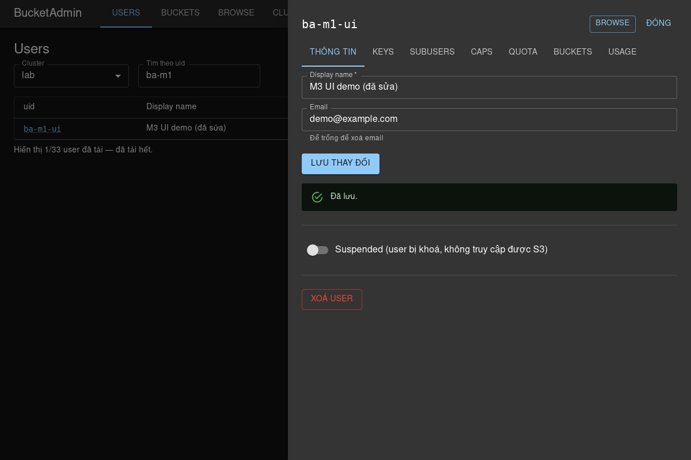
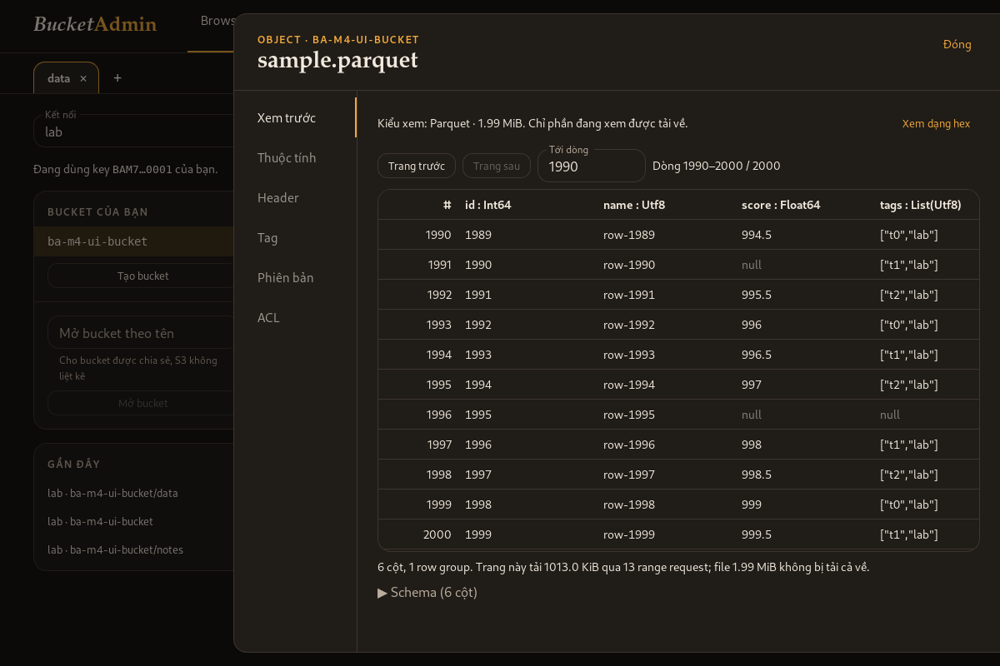
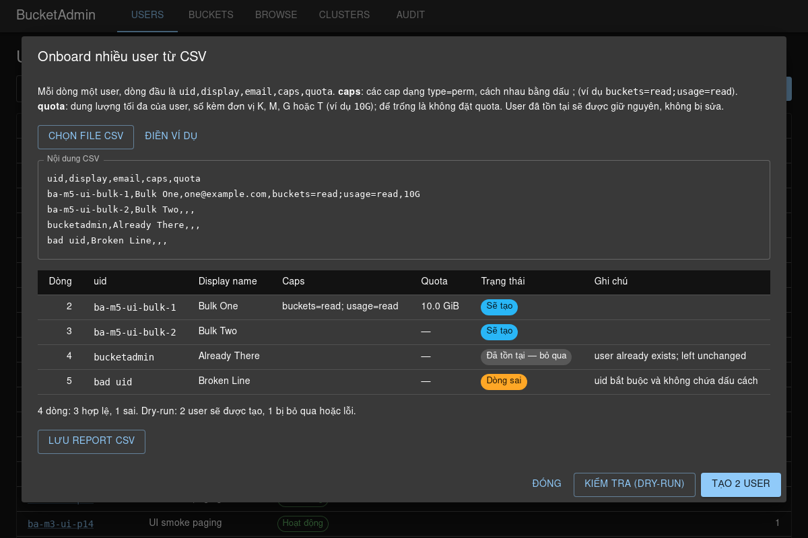
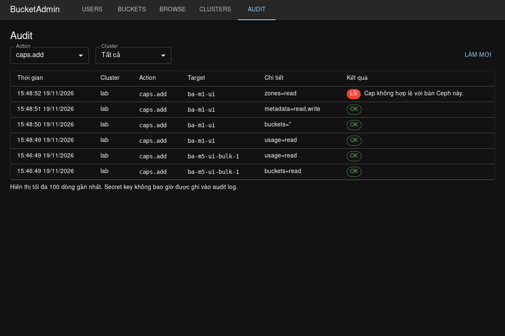

# BucketAdmin

Ứng dụng desktop cho Linux để **quản trị Ceph RGW** (S3): user, key, caps, quota, usage, bucket — và **duyệt bucket** với
xem trước file ngay trong app. Viết bằng Tauri 2 + Rust, giao diện tiếng Việt.

BucketAdmin nói chuyện với RGW qua hai đường chuẩn: **Admin Ops API** (cho phần quản trị) và **S3** (cho phần duyệt bucket).
Không cần cài gì lên cụm Ceph, không có server trung gian.



## Tính năng

**Quản trị (Admin Ops API)**

- Nhiều cluster cùng lúc; secret của admin nằm trong keychain của hệ điều hành, không ghi ra file.
- Proxy chọn được trong app (tab **Clusters**): tự động theo biến môi trường, không dùng proxy, hoặc một proxy tự nhập;
  đặt chung cho cả app và đổi riêng cho từng cluster. Endpoint nội bộ được gợi ý "Không dùng proxy".
- User: danh sách có phân trang, tạo, sửa, suspend / enable, xoá (tuỳ chọn xoá cả dữ liệu).
- Key: tạo, xoá, rotate, thêm key có sẵn. Secret chỉ hiện đúng một lần lúc tạo.
- Subuser (Swift), caps, quota theo user và theo bucket, usage theo khoảng ngày (export CSV, xoá usage cũ).
- Bucket: danh sách kèm owner / dung lượng / số object, xem bucket policy, quota riêng, xoá bucket rỗng.
- **Onboard hàng loạt từ CSV**: dry-run trước, chạy sau, có report từng dòng.
- **Audit log** cục bộ (SQLite) cho mọi thao tác thay đổi; không bao giờ chứa secret hay presigned URL.

**Duyệt bucket (S3)**

- Duyệt với key của **chính user được chọn**, nên bạn thấy đúng những gì user đó thấy. Admin secret không dùng cho S3.
- Tạo bucket, tạo thư mục, upload (chọn file hoặc kéo-thả, multipart), download có resume, xoá một hoặc nhiều object.
- Hàng đợi task: chạy song song, tiến độ theo từng phần, huỷ được.
- Xem trước mà không tải cả file: văn bản / JSON / YAML (có tìm kiếm), CSV / TSV, **Parquet** (chỉ tải footer và các page cần xem),
  ảnh, audio / video, PDF, hex. Văn bản và bảng dừng ở 20 MiB; ảnh và PDF lớn thì app hỏi trước khi tải.
- Xem chi tiết object theo tab: Properties, Headers (HEAD thật), Tags (đọc và sửa), Phiên bản, ACL.
- ACL kiểu chia sẻ nhanh: bảng Chủ sở hữu / User đã xác thực / Mọi người × 5 quyền, ba preset (riêng tư, public-read,
  authenticated-read), áp dụng một ACL cho mọi object trong một thư mục hoặc cả bucket.
- Versioning: bật / tắt ngay trên trang Browse. Bucket đang bật versioning thì xoá nhầm hoàn tác được (nút Hoàn tác, hoặc
  "Hiện object đã xoá" rồi khôi phục trong tab Phiên bản); bucket không bật thì app cảnh báo đỏ trước khi xoá.
- Mọi thời gian hiển thị theo giờ Việt Nam (UTC+7).
- **Copy URL**: presigned URL 15 phút của object đang chọn, vào thẳng clipboard.
- Presigned URL với thời hạn tuỳ chọn, versions (khôi phục, xoá từng version), ACL của object và bucket, tìm kiếm đệ quy có giới hạn.




## Cài đặt

Yêu cầu: Ubuntu 22.04 trở lên (amd64), có dịch vụ keyring (GNOME Keyring hoặc tương đương — mặc định có sẵn trên Ubuntu desktop).

1. Tải file `bucketadmin_<phiên bản>_amd64.deb` từ trang **Releases** của repo.
2. Cài:

   ```bash
   sudo apt install ./bucketadmin_<phiên bản>_amd64.deb
   ```

3. Mở **BucketAdmin** từ menu ứng dụng, hoặc gõ `bucketadmin`.

Gỡ: `sudo apt remove bucketadmin`. Dữ liệu của app nằm ở `~/.local/share/bucketadmin/` (danh sách cluster, audit log).

Để phát được video / audio nén trong phần xem trước, máy cần codec của GStreamer:
`sudo apt install gstreamer1.0-libav gstreamer1.0-plugins-good`.

## Quickstart cho đội sys

**1. Tạo một admin user cho app trên RGW** (chạy trên node quản trị Ceph, một lần):

```bash
radosgw-admin user create --uid=bucketadmin --display-name="BucketAdmin App" \
  --caps="users=*;buckets=*;usage=*;metadata=read;info=read"
```

Ghi lại `access_key` và `secret_key` trong kết quả. Nếu chỉ cần một phần tính năng, xem bảng caps bên dưới.

**2. Thêm cluster trong app.** Tab **Clusters** → điền tên, endpoint (ví dụ `https://rgw.example.com` hoặc `http://rgw.example.com:7480`),
access key, secret key → **Kiểm tra kết nối** → **Lưu**.

**3. Quản lý user.** Tab **Users**: tạo user, mở một user để xem / sửa key, subuser, caps, quota, bucket, usage.

**4. Onboard nhiều user một lúc.** Tab **Users** → **Onboard từ CSV**. File có dòng đầu cố định:

```csv
uid,display,email,caps,quota
an.nguyen,Nguyen Van An,an@example.com,buckets=read;usage=read,10G
binh.tran,Tran Thi Binh,,,
```

- `caps`: các cap dạng `type=perm`, cách nhau bằng dấu `;`. Để trống nếu user không cần cap quản trị.
- `quota`: dung lượng tối đa của user, số kèm đơn vị `K`, `M`, `G` hoặc `T` (ví dụ `10G`). Để trống là không đặt quota.
- Bấm **Kiểm tra (dry-run)** để xem dòng nào sẽ được tạo, dòng nào đã tồn tại, dòng nào sai; rồi **Tạo N user**.
- User đã tồn tại được giữ nguyên. **Lưu report CSV** để có access key / secret key của các user mới (secret không xem lại được).



**5. Duyệt bucket của một user.** Mở user → **Browse**, hoặc tab **Browse** rồi nhập uid. App duyệt bằng key của user đó.

**6. Xem lại ai đã làm gì.** Tab **Audit**.



## Caps cần cho từng tính năng

Caps là của **admin user mà app dùng** (bước 1 ở trên). Bảng lập theo tài liệu Admin Ops của Ceph; app đã được chạy thật với bộ caps đầy đủ
trong lệnh ở bước 1, từng cap riêng lẻ chưa được thử tách bạch.

| Tính năng | Caps cần |
|---|---|
| Kiểm tra kết nối | `info=read` |
| Danh sách user | `metadata=read`, `users=read` |
| Xem chi tiết user, quota | `users=read` |
| Tạo / sửa / xoá user, key, subuser, caps, đặt quota user | `users=write` |
| Onboard từ CSV | `users=read`, `users=write` |
| Danh sách bucket, chi tiết bucket | `buckets=read` |
| Xem bucket policy | `metadata=read` |
| Quota của từng bucket, xoá bucket | `buckets=write` |
| Xem usage | `usage=read` |
| Xoá usage cũ | `usage=write` |
| Duyệt bucket với key của một user | `users=read` (để lấy key của user đó); phần S3 theo quyền của chính user |

Thiếu cap thì thao tác tương ứng báo "Không đủ quyền", các phần khác vẫn dùng được.

## Bảo mật

- Secret của admin: chỉ trong keychain của hệ điều hành.
- Duyệt bucket: ký bằng key của user được chọn; secret đó chỉ nằm trong bộ nhớ của app.
- Cửa sổ chính không tải bất kỳ tài nguyên nào từ ngoài app; xem trước ảnh / media / PDF nằm trong một khung riêng chỉ được phép
  tải từ đúng endpoint của cluster.
- Presigned URL: mặc định 15 phút; audit log ghi việc tạo URL nhưng không ghi URL.
- Kiểm tra bản mới: mỗi ngày tối đa một request tới `api.github.com` (qua cài đặt proxy của app) để đọc tag release mới nhất.
  Request không mang dữ liệu nào của bạn; không tới được GitHub thì app im lặng bỏ qua.

Chi tiết từng directive của CSP và cách xử lý presigned URL: [docs/SECURITY.md](docs/SECURITY.md).

## Lỗi thường gặp

| Hiện tượng | Nguyên nhân và cách xử lý |
|---|---|
| "Secret key của cluster không đúng" (SignatureDoesNotMatch) | Sai secret key, hoặc đồng hồ máy lệch nhiều so với cụm. Kiểm tra lại key và `timedatectl`. |
| "Access key không tồn tại trên cluster này" | Access key gõ sai, hoặc endpoint trỏ sang cụm khác. |
| "Không đủ quyền: admin user của cluster thiếu caps" | Admin user thiếu cap cho thao tác đó. Xem bảng caps ở trên, thêm bằng `radosgw-admin caps add`. |
| "Không kết nối được tới RGW", hoặc lỗi HTTP 502 / 504 / 407 | Sai endpoint / port, hoặc request đang đi qua proxy mà proxy không tới được cụm. Với endpoint nội bộ: tab **Clusters** → Proxy của cluster đó → **Không dùng proxy**. |
| "Không tìm thấy (HTTP 404)" khi kiểm tra kết nối | Endpoint không phải RGW, hoặc Admin API bị tắt / đổi đường dẫn trên cụm. |
| Usage luôn trống | RGW chưa bật ghi usage: đặt `rgw_enable_usage_log = true` rồi restart RGW. |
| Xoá user báo "Bucket đã tồn tại… user vẫn còn bucket" | User còn bucket. Xoá bucket trước, hoặc chọn "Xoá cả dữ liệu của user". |
| Xoá user kèm dữ liệu báo hết thời gian chờ | User có rất nhiều object; RGW xoá lâu hơn 30 giây. Xoá bớt object trong Browse trước, rồi xoá user. |
| Browse báo "Key của user này không có quyền" | Đúng như tên gọi: key của user đó bị policy, ACL hoặc op-mask chặn. Đây là quyền thật của user. |
| Không lưu được cluster, báo lỗi keychain | Máy không có dịch vụ keyring đang mở khoá. Cài / mở GNOME Keyring (`gnome-keyring`) rồi thử lại. |
| App mở chậm khoảng 25 giây | Gặp khi phiên làm việc không có dịch vụ keyring (máy tối giản, phiên SSH + X): desktop portal chờ keyring rồi mới trả lời. Trong phiên desktop đầy đủ có GNOME Keyring đang chạy thì app mở ngay. |
| Video / audio không phát trong phần xem trước | Thiếu codec GStreamer, xem mục Cài đặt. |
| `apt install` từ chối vì `libc6` | Gói được build cho bản Ubuntu mới hơn máy bạn. Dùng gói build cho Ubuntu 22.04 trên trang Releases. |

## Phát triển

```bash
npm ci
npm run tauri dev                      # chạy app ở chế độ phát triển
npm test && npm run build              # test và build frontend
cd src-tauri && cargo fmt --check && cargo clippy --all-targets -- -D warnings && cargo test
scripts/build-deb.sh 0.1.0~dev1        # đóng gói deb
scripts/render-gate.sh bucketadmin_0.1.0~dev1_amd64.deb   # kiểm tra gói vừa build có hiện giao diện thật
```

Test tích hợp với một RGW thật chạy khi có biến môi trường `RGW_ACCESS_KEY`, `RGW_SECRET_KEY` (và `RGW_ENDPOINT`, mặc định
`http://127.0.0.1:7480`); không có thì các test đó tự bỏ qua. Dùng một cụm thử nghiệm, không dùng cụm thật: test tạo và xoá user, bucket.

## Giấy phép

MIT — xem [LICENSE](LICENSE).
