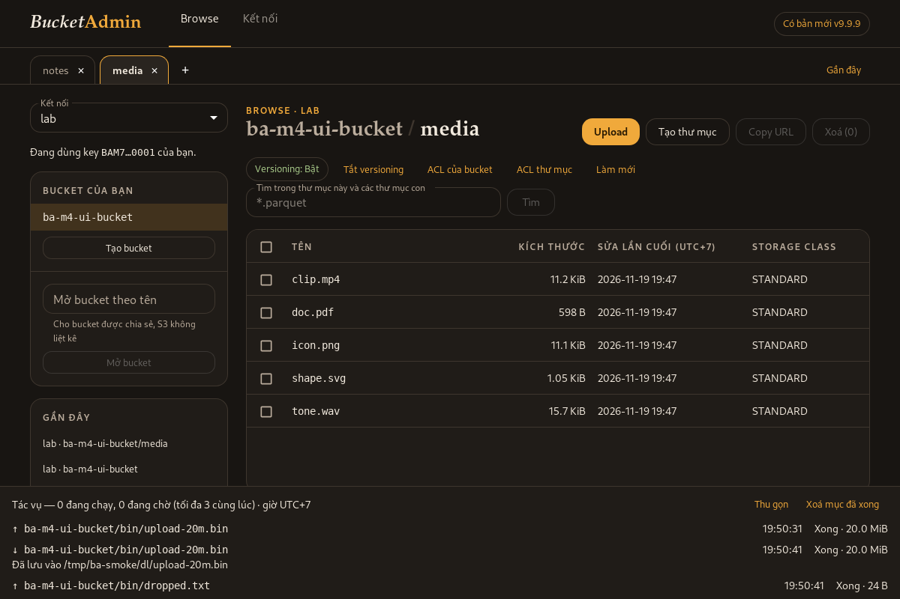
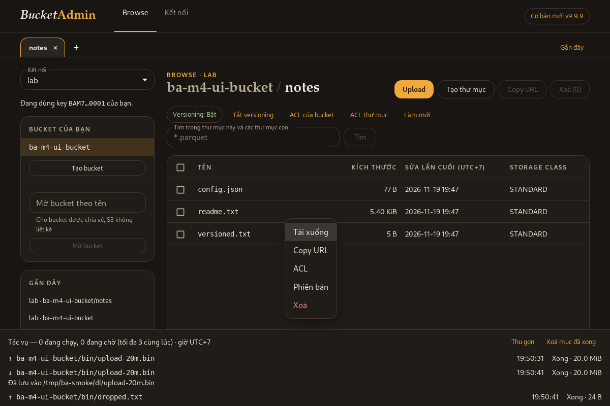

# BucketAdmin

Trình duyệt S3 dạng desktop cho Linux, làm cho **Ceph RGW**: duyệt bucket bằng key của chính bạn, nhiều tab như trình duyệt,
xem trước file ngay trong app mà không tải cả file, ACL, phiên bản, presigned URL. Viết bằng Tauri 2 + Rust, giao diện tiếng Việt.

App nói chuyện thẳng với endpoint S3 của RGW. Không cần cài gì lên cụm Ceph, không có server trung gian, không cần quyền admin.



Ảnh trong tài liệu này chụp từ bài smoke test chạy với một cụm thử nghiệm; huy hiệu "Có bản mới v9.9.9" là câu trả lời giả lập
của bài test cho phần kiểm tra bản mới.

## Tính năng

- **Kết nối**: mỗi kết nối là một endpoint cùng S3 key của bạn (giống key đang dùng với rclone, s3cmd). Secret nằm trong
  keychain của hệ điều hành, không ghi ra file. Proxy chọn được cho cả app và riêng từng kết nối: tự động theo biến môi trường,
  không dùng proxy, hoặc một proxy tự nhập; endpoint nội bộ được gợi ý "Không dùng proxy".
- **Nhiều tab**: mỗi tab ở một vị trí (kết nối + bucket + thư mục) và giữ nguyên danh sách, vị trí cuộn, các dòng đang chọn khi
  bạn sang tab khác. `Ctrl+T` tab mới, `Ctrl+W` đóng, `Ctrl+Tab` / `Ctrl+Shift+Tab` chuyển tab.
- **Gần đây**: 20 vị trí mở gần nhất, nhớ qua các lần mở app; chọn một vị trí là mở thành tab (vị trí đang mở sẵn thì chuyển
  sang tab đó).
- Tạo bucket, tạo thư mục, upload (chọn file hoặc kéo-thả, multipart), download có resume, xoá một hoặc nhiều object.
  Hàng đợi tác vụ dùng chung cho mọi tab: chạy song song, tiến độ theo từng phần, huỷ được.
- **Xem trước mà không tải cả file**: văn bản / JSON / YAML (có tìm kiếm), CSV / TSV, **Parquet** (chỉ tải footer và các page
  cần xem), ảnh, audio / video, PDF, hex. Văn bản và bảng dừng ở 20 MiB; ảnh và PDF lớn thì app hỏi trước khi tải.
- **Menu chuột phải** trên từng dòng: Tải xuống, Copy URL, ACL, Phiên bản, Xoá.
- Tấm chi tiết object mở từ bên phải, các mục xếp dọc: Xem trước, Thuộc tính, Header (HEAD thật), Tag, Phiên bản, ACL.
- **ACL kiểu chia sẻ nhanh**: bảng Chủ sở hữu / User đã xác thực / Mọi người × 5 quyền, ba preset (riêng tư, public-read,
  authenticated-read), áp dụng một ACL cho mọi object trong một thư mục hoặc cả bucket; cảnh báo đỏ khi mở cho Mọi người.
- **Versioning**: bật / tắt ngay trên trang. Bucket đang bật versioning thì xoá nhầm hoàn tác được (nút Hoàn tác, hoặc
  "Hiện object đã xoá" rồi khôi phục trong mục Phiên bản); bucket không bật thì app cảnh báo đỏ trước khi xoá.
- **Copy URL**: presigned URL 15 phút của object, vào thẳng clipboard; thời hạn khác thì đặt trong mục Thuộc tính.
- Tìm kiếm đệ quy có giới hạn (`*.parquet`, `logs/2026-*`…).
- Mọi thời gian hiển thị theo giờ Việt Nam (UTC+7).
- Mọi thay đổi bạn làm (upload, xoá, đổi ACL…) được ghi vào một audit log cục bộ (SQLite, `audit.db` trong thư mục dữ liệu của
  app); log không bao giờ chứa secret hay presigned URL.





## Cài đặt

Yêu cầu: Ubuntu 22.04 trở lên (amd64), có dịch vụ keyring (GNOME Keyring hoặc tương đương — mặc định có sẵn trên Ubuntu desktop).

1. Tải file `bucketadmin_<phiên bản>_amd64.deb` từ trang **Releases** của repo.
2. Cài:

   ```bash
   sudo apt install ./bucketadmin_<phiên bản>_amd64.deb
   ```

3. Mở **BucketAdmin** từ menu ứng dụng, hoặc gõ `bucketadmin`.

Gỡ: `sudo apt remove bucketadmin`. Dữ liệu của app nằm ở `~/.local/share/bucketadmin/` (danh sách kết nối, cài đặt, audit log).

Để phát được video / audio nén trong phần xem trước, máy cần codec của GStreamer:
`sudo apt install gstreamer1.0-libav gstreamer1.0-plugins-good`.

## Bắt đầu nhanh

**1. Thêm kết nối.** Mục **Kết nối** → điền tên, endpoint (ví dụ `https://rgw.example.com` hoặc `http://rgw.example.com:7480`),
access key và secret key của bạn → **Kiểm tra kết nối** → **Lưu**. Bước kiểm tra chỉ liệt kê bucket qua S3, nên key thường
không có caps nào cũng dùng được.

**2. Duyệt.** Mục **Browse** → chọn một bucket. Bucket được chia sẻ cho bạn (S3 không liệt kê) thì mở theo tên ở cột bên trái.

**3. Làm việc với object.** Bấm vào tên để xem trước; chuột phải vào dòng để mở menu; tick nhiều dòng để xoá một lượt; kéo thả
file vào cửa sổ để upload vào thư mục đang mở.

**4. Chia sẻ.** "ACL của bucket" / "ACL thư mục" trên thanh công cụ, hoặc ACL của từng object trong menu chuột phải.

### Key admin (không bắt buộc)

Khi thêm kết nối có thể nhập thêm một key admin. App chỉ dùng nó cho hai việc, và không bao giờ dùng nó để ký request S3:

| Việc | Caps cần ở key admin |
|---|---|
| Khung "Thông tin của tôi" trong Browse: thông tin, quota của user sở hữu key của bạn | `users=read` |
| Usage 30 ngày trong khung đó | `usage=read` |
| "Duyệt thay user (uid)": duyệt bằng key của một user khác | `users=read` |

Nếu chính key của bạn có các caps trên thì không cần key admin: khung "Thông tin của tôi" tự hiện.
Các màn hình quản trị cụm (user, key, caps, quota, onboarding từ CSV) đã được gỡ khỏi app từ bản 0.1.0.

## Bảo mật

- Secret key: chỉ trong keychain của hệ điều hành; giao diện không bao giờ nhận được secret.
- Duyệt bucket: ký bằng key của bạn. Khi "duyệt thay user", app lấy key của user đó bằng key admin và chỉ giữ nó trong bộ nhớ.
- Cửa sổ chính không tải bất kỳ tài nguyên nào từ ngoài app; xem trước ảnh / media / PDF nằm trong một khung riêng chỉ được phép
  tải từ đúng endpoint của cluster.
- Presigned URL: mặc định 15 phút; audit log ghi việc tạo URL nhưng không ghi URL.
- Kiểm tra bản mới: mỗi ngày tối đa một request tới `api.github.com` (qua cài đặt proxy của app) để đọc tag release mới nhất.
  Request không mang dữ liệu nào của bạn; không tới được GitHub thì app im lặng bỏ qua.

Chi tiết từng directive của CSP và cách xử lý presigned URL: [docs/SECURITY.md](docs/SECURITY.md).

## Lỗi thường gặp

| Hiện tượng | Nguyên nhân và cách xử lý |
|---|---|
| "Secret key … không khớp" / "không đúng" (SignatureDoesNotMatch) | Sai secret key, hoặc đồng hồ máy lệch nhiều so với cụm. Kiểm tra lại key và `timedatectl`. |
| "Access key không tồn tại trên cluster này" | Access key gõ sai, hoặc endpoint trỏ sang cụm khác. |
| "Không đủ quyền: key của cluster này thiếu caps …" | Chỉ gặp ở khung "Thông tin của tôi" hoặc khi duyệt thay user: key admin (hoặc key của bạn) thiếu cap đó. Thông báo kèm sẵn lệnh `radosgw-admin caps add` để gửi cho quản trị cụm. |
| "Không kết nối được tới RGW", hoặc lỗi HTTP 502 / 504 / 407 | Sai endpoint / port, hoặc request đang đi qua proxy mà proxy không tới được cụm. Với endpoint nội bộ: mục **Kết nối** → Proxy của kết nối đó → **Không dùng proxy**. |
| "Bucket không tồn tại" / lỗi HTTP 404 khi kiểm tra kết nối | Endpoint không phải là địa chỉ S3 của RGW (sai host, sai port, hoặc trỏ vào dashboard). |
| Usage trong "Thông tin của tôi" luôn trống | RGW chưa bật ghi usage: quản trị cụm đặt `rgw_enable_usage_log = true` rồi restart RGW. |
| "Key của user này không có quyền" | Đúng như tên gọi: key đang dùng bị policy, ACL hoặc op-mask chặn. Đây là quyền thật của key. |
| Không lưu được kết nối, báo lỗi keychain | Máy không có dịch vụ keyring đang mở khoá. Cài / mở GNOME Keyring (`gnome-keyring`) rồi thử lại. |
| App mở chậm khoảng 25 giây | Gặp khi phiên làm việc không có dịch vụ keyring (máy tối giản, phiên SSH + X): desktop portal chờ keyring rồi mới trả lời. Trong phiên desktop đầy đủ có GNOME Keyring đang chạy thì app mở ngay. |
| Video / audio không phát trong phần xem trước | Thiếu codec GStreamer, xem mục Cài đặt. |
| `apt install` từ chối vì `libc6` | Gói được build cho bản Ubuntu mới hơn máy bạn. Dùng gói build cho Ubuntu 22.04 trên trang Releases. |

## Phát triển

```bash
npm ci
npm run tauri dev                      # chạy app ở chế độ phát triển
npm test && npm run build              # test và build frontend
cd src-tauri && cargo fmt --check && cargo clippy --all-targets -- -D warnings && cargo test
scripts/build-deb.sh 0.1.0~dev1        # đóng gói deb
scripts/render-gate.sh bucketadmin_0.1.0~dev1_amd64.deb   # kiểm tra gói vừa build có hiện giao diện thật
python3 scripts/gen-icons.py           # render lại bộ icon từ src-tauri/icons/icon.svg (cần google-chrome, Pillow)
```

Smoke test toàn bộ giao diện trên app thật với một RGW thử nghiệm (Xvfb; xem đầu file để biết các công cụ cần có):

```bash
npx tauri build --debug --no-bundle
xvfb-run -a -s "-screen 0 1280x900x24" scripts/ui-smoke/ui-smoke.sh "$PWD/src-tauri/target/debug/bucketadmin"
```

Test tích hợp với một RGW thật chạy khi có biến môi trường `RGW_ACCESS_KEY`, `RGW_SECRET_KEY` (và `RGW_ENDPOINT`, mặc định
`http://127.0.0.1:7480`); không có thì các test đó tự bỏ qua. Dùng một cụm thử nghiệm, không dùng cụm thật: test tạo và xoá user, bucket.

## Giấy phép

MIT — xem [LICENSE](LICENSE).
