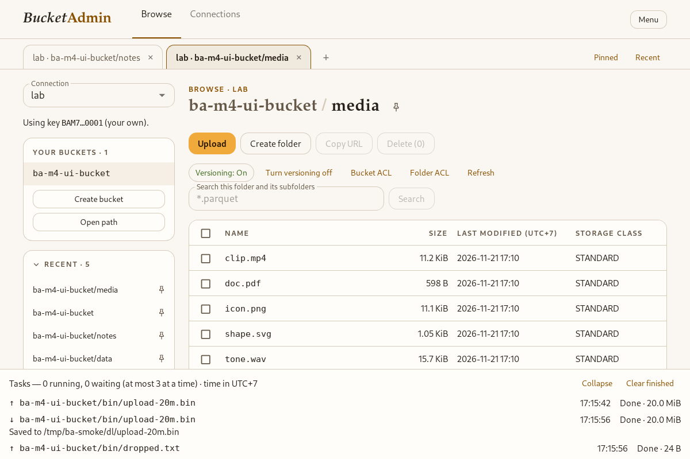
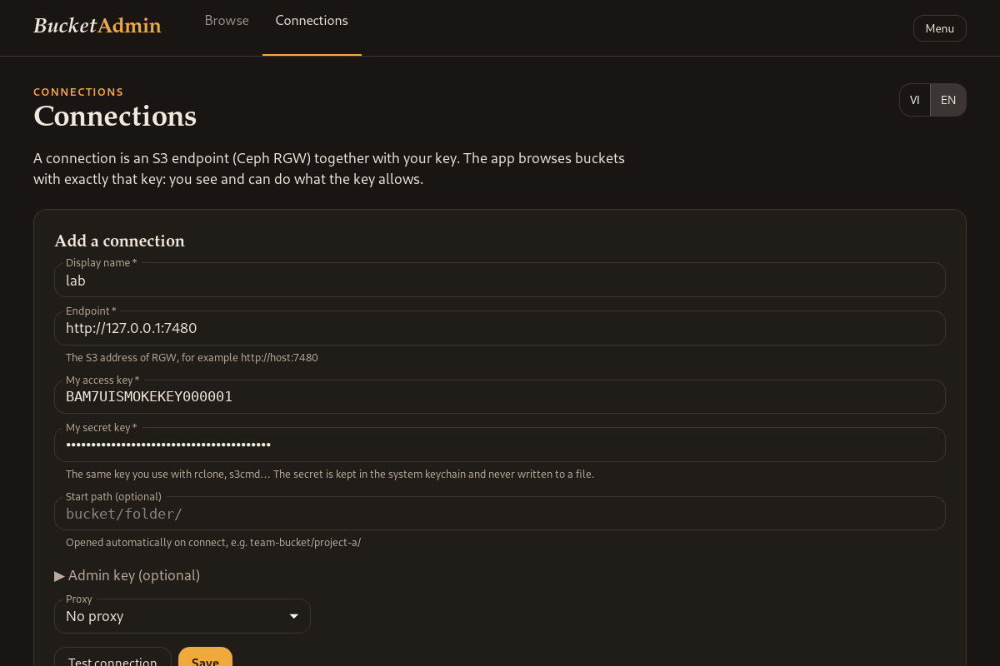
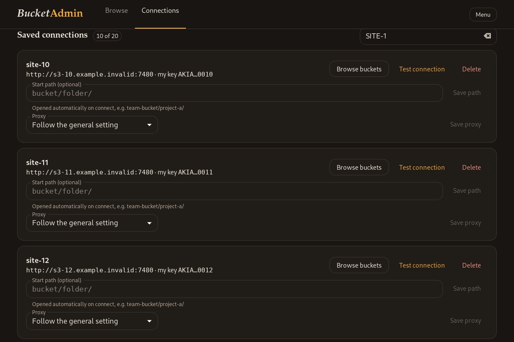
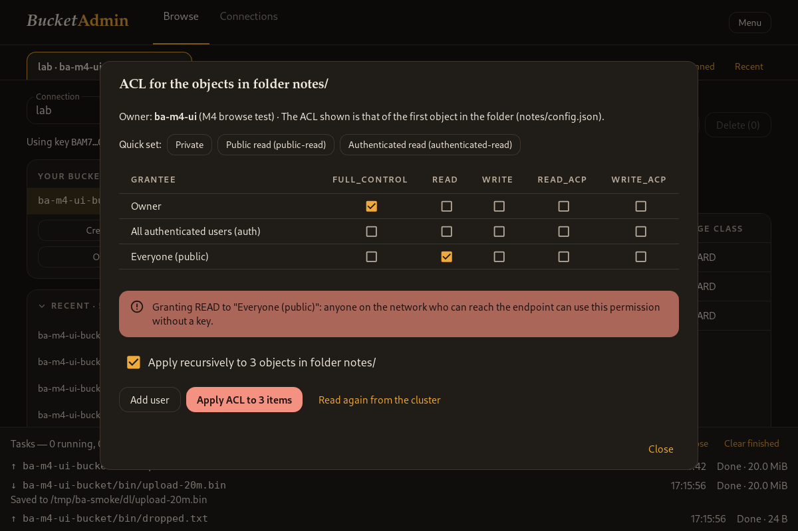
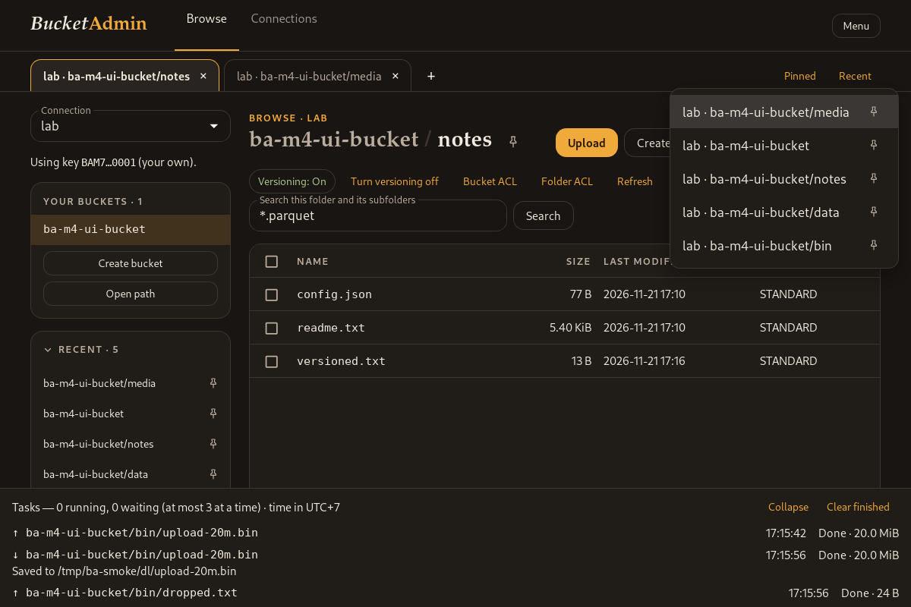
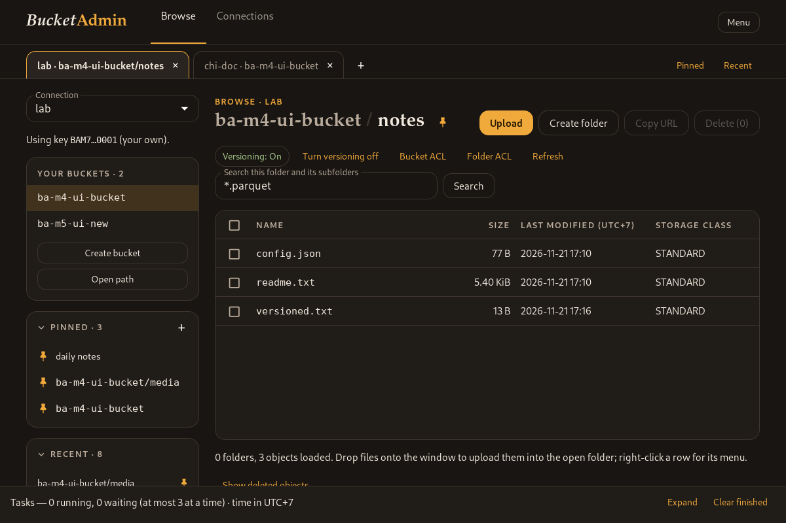
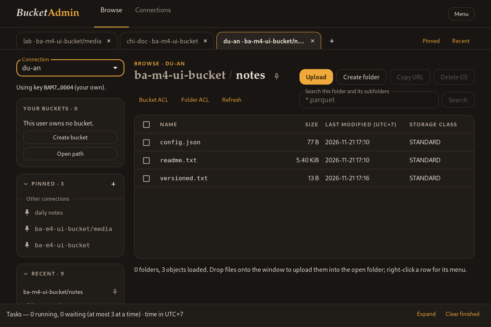
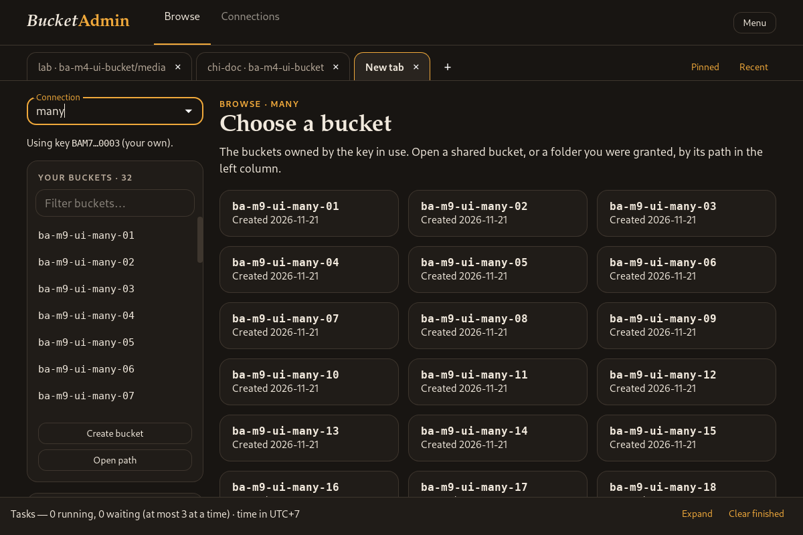
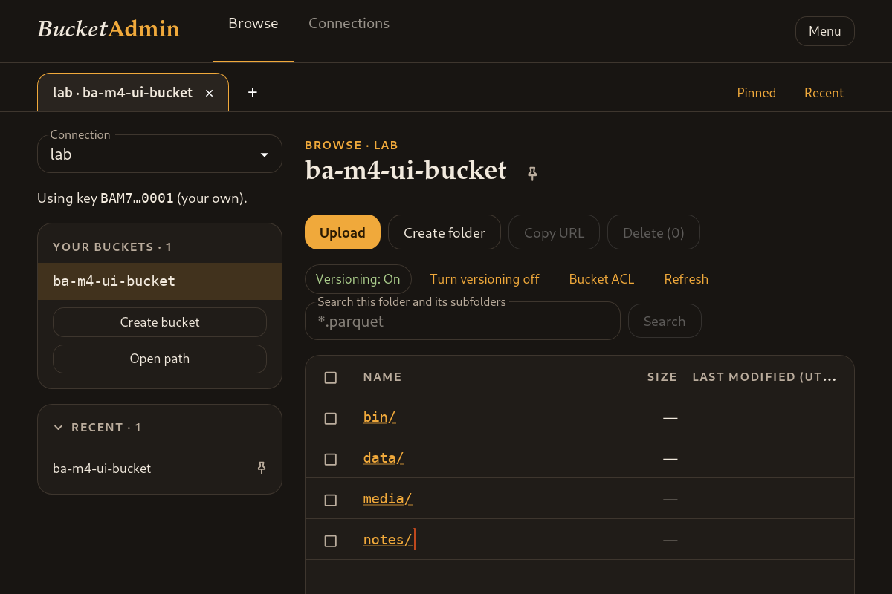
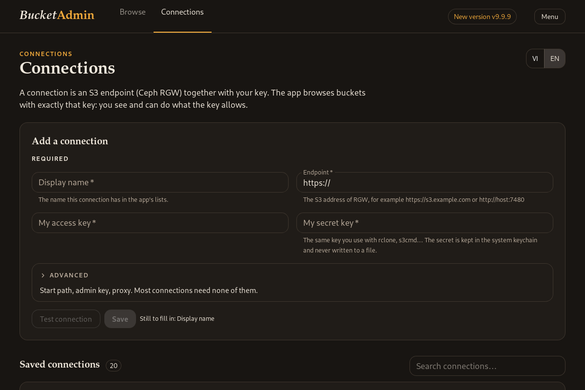

# BucketAdmin

🇻🇳 [Tiếng Việt](README.vi.md)

A desktop S3 browser for Linux, made for **Ceph RGW**: browse buckets with your own key, in tabs like a web browser, preview
files inside the app without downloading them whole, ACLs, versions, presigned URLs. Written in Tauri 2 + Rust; the interface
speaks English and Vietnamese.

The app talks straight to the S3 endpoint of RGW. Nothing to install on the Ceph cluster, no server in between, no admin rights
needed.


The pictures in this document come from the smoke test, run against a test cluster.

## Features

- **Connections**: a connection is an endpoint together with your S3 key (the same key you use with rclone or s3cmd). The
  secret lives in the operating system's keychain and is never written to a file. A proxy can be chosen for the whole app and
  for each connection: automatic (environment variables), no proxy, or one you enter; for an internal endpoint the app
  suggests "No proxy".
- **Tabs**: each tab is at one place (connection + bucket + folder) and keeps its listing, scroll position and ticked rows
  while you are in another tab (shortcuts: see Shortcuts). The open tabs come back when the app is started again.
- **Open path**: type `bucket` or `bucket/folder/` to go straight there, also when your key may only list that one folder;
  a connection can have a start path that is opened by itself (see Scoped access).
- **Pinned**: bookmarks to buckets and to folders deep inside them, one click away in the left column and in the app bar,
  remembered between runs (see Pinned places).
- **Bucket list**: however many buckets the key owns, the list keeps a fixed height and scrolls inside its card; a filter
  field appears above 8 buckets (`↑` `↓` move, `Enter` opens, `Esc` clears) and the header shows the count.
- **See-your-access path picker**: Open path, pinning a typed path and a connection's start path share one picker. It shows
  "Paths you can open" (start path, pins, recent places, and, when the key may read it, what a bucket policy grants) and, as
  you type, the folders S3 lists at exactly that path, one click to go deeper. When the key may not list there, an amber hint
  says so; the path can still be opened. Nothing is ever listed above what you typed.
- **Dark & light themes**: a warm-charcoal dark theme and a warm-paper light theme with the same amber accent, chosen in the
  app-bar menu or in General settings and remembered (no flash at start; no "follow the system" mode).
- **Scales to hundreds of buckets and many connections**: the bucket list mounts only the rows in view (500 buckets cost what
  30 do); above 8 connections the Connections screen and a tab's connection box become searchable, repeated labels are
  flagged, tabs read `connection · bucket` and the tab bar scrolls; Recent is grouped per connection like Pinned.
- **Audit log** (app-bar menu): a read-only table of what the app changed, with a filter and today / 7 days / 30 days / all.
- **Recent**: the 20 places opened last, remembered between runs; choosing one opens it as a tab (a place that is already
  open is shown in its tab).
- Create buckets and folders, upload (pick files or drag and drop, multipart), download with resume, delete one or many
  objects. One task queue serves every tab: transfers run in parallel, show progress part by part, and can be cancelled.
- **Preview without downloading the whole file**: text / JSON / YAML (with find), CSV / TSV, **Parquet** (only the footer and
  the pages on screen are fetched), images, audio / video, PDF, hex. Text and tables stop at 20 MiB; for a large image or PDF
  the app asks first.
- **Right-click menu** on every row: Download, Copy URL, ACL, Versions, Delete.
- The object sheet opens from the right, its sections stacked vertically: Preview, Properties, Headers (a real HEAD), Tags,
  Versions, ACL.
- **Quick-share ACL**: a table of Owner / Authenticated users / Everyone × 5 permissions, three presets (private,
  public-read, authenticated-read), one ACL for every object of a folder or of a whole bucket; a red warning when access is
  opened to Everyone.
- **Versioning**: switched on and off right on the page. In a bucket with versioning on, a mistaken delete can be undone (the
  Undo button, or "Show deleted objects" and then restore under Versions); without versioning the app warns in red before
  deleting.
- **Copy URL**: a 15-minute presigned URL of the object, straight to the clipboard; another lifetime can be set under
  Properties.
- Recursive search with limits (`*.parquet`, `logs/2026-*`…).
- Every time is shown in Vietnam time (UTC+7), in both languages.
- **General settings** (at the bottom of the Connections screen): the proxy for the whole app; the interface size, with an
  `A- 100% A+` stepper (80, 90, 100, 110, 125, 150%) that makes the whole app bigger or smaller like a browser's zoom and is
  remembered for the next run; the language, `VI | EN`, which switches at once, without a restart. On first run the app
  follows the system's language.
- Every change you make (upload, delete, ACL change…) is written to a local audit log (SQLite, `audit.db` in the app's data
  folder); the log never holds a secret or a presigned URL.





















## Install

Requirements: Ubuntu 22.04 or later (amd64) with a keyring service (GNOME Keyring or equivalent — present by default on
Ubuntu desktop).

```bash
wget https://github.com/DucLong06/bucketadmin/releases/download/v0.1.3/bucketadmin_0.1.3_amd64.deb
sudo apt install ./bucketadmin_0.1.3_amd64.deb
```

Other formats and older versions: the [Releases](https://github.com/DucLong06/bucketadmin/releases) page.

Open **BucketAdmin** from the applications menu, or type `bucketadmin`.

Remove: `sudo apt remove bucketadmin`. The app's data is in `~/.local/share/bucketadmin/` (connections, settings, audit log).

To play compressed video / audio in the preview, the machine needs GStreamer's codecs:
`sudo apt install gstreamer1.0-libav gstreamer1.0-plugins-good`.

## Quick start

**1. Add a connection.** **Connections** → fill in a name, the endpoint (for example `https://rgw.example.com` or
`http://rgw.example.com:7480`), your access key and secret key → **Test connection** → **Save**. The test only lists buckets
over S3, so an ordinary key without any caps works.

**2. Browse.** **Browse** → choose a bucket. A bucket that is shared with you (S3 does not list those) is opened by its path
under **Open path** in the left column.

**3. Work with objects.** Click a name to preview it; right-click a row for its menu; tick several rows to delete them in one
go; drop files onto the window to upload them into the open folder.

**4. Share.** "Bucket ACL" / "Folder ACL" in the toolbar, or the ACL of a single object from the right-click menu.

### Scoped access (one folder only)

On many clusters a user is granted a single folder of somebody else's bucket: the bucket policy allows listing only under
one prefix, and often the key may not list buckets at all. Such a key works like this:

- **Open path** (left column of Browse) takes `bucket` or `bucket/folder/…` and lands exactly there. `s3://bucket/folder/` and
  a leading `/` mean the same; the path of a file (`bucket/folder/report.csv`) opens the folder the file is in. A folder whose
  name looks like a file name (`v1.2`) needs its trailing `/`.
- **Start path** (optional field of a connection, also editable on a saved one): `team-bucket/project-a/` is opened by itself
  whenever that connection is opened, in every new tab.
- When the key may not list buckets, the bucket card says so instead of showing an error, and the keyboard is already in the
  Open-path field. "Test connection" passes for such a key and tells you to set a start path.
- The breadcrumb still leads upwards. Above your folder S3 answers "not allowed"; the message then points back to Open path.

### Pinned places

Pin what you use every day: a bucket, or a folder any number of levels down.

- Pin the place that is open with the pin button at the end of the breadcrumb row, or with `Ctrl+D`; the same again unpins it.
- Right-click a bucket in the left column, or a folder in the list, for "Pin bucket" / "Pin this folder"; every row of Recent
  has a pin button too.
- The **Pinned** card in the left column lists the pins of the connection you are browsing first and those of other
  connections under a divider. A click opens the place in the current tab; `Ctrl`+click or the middle button opens a new tab.
- Right-click a pin to open it in a new tab, rename it, unpin it, or move it up or down. Up to 100 pins are kept.
- The **Pinned** button next to Recent in the app bar lists the first 15 from anywhere in the app.
- In the left column the bucket list comes first; the **Pinned** and **Recent** cards follow it. A click on a card's heading
  folds the card to that one line (remembered between runs), and Recent shows the 5 newest places until "Show all".

### Admin key (optional)

When adding a connection you may also enter an admin key. The app uses it for two things only, and never to sign S3 requests:

| What | Caps the admin key needs |
|---|---|
| The "My info" panel in Browse: the record and quota of the user your key belongs to | `users=read` |
| 30 days of usage in that panel | `usage=read` |
| "Browse as user (uid)": browsing with another user's key | `users=read` |

If your own key has those caps, no admin key is needed: the "My info" panel appears by itself.
The cluster administration screens (users, keys, caps, quotas, onboarding from CSV) were removed from the app in 0.1.0.

## Shortcuts

| Keys | What |
|---|---|
| `Ctrl+T` | New tab |
| `Ctrl+W` | Close the current tab |
| `Ctrl+Tab` / `Ctrl+Shift+Tab` | Next / previous tab |
| `Ctrl+D` | Pin or unpin the place that is open |
| `Ctrl+=` (or `Ctrl++`) | Interface one step bigger |
| `Ctrl+-` | Interface one step smaller |
| `Ctrl+0` | Back to 100% |
| `Ctrl+F` | Find in the text file being previewed |

## Security

- Secret keys: only in the operating system's keychain; the interface never receives a secret.
- Browsing: signed with your key. When browsing as another user, the app fetches that user's key with the admin key and keeps
  it in memory only.
- The main window loads no resource from outside the app; image / media / PDF previews live in a separate frame that may only
  load from the cluster's own endpoint.
- Presigned URLs: 15 minutes by default; the audit log records that a URL was made, not the URL.
- Update check: at most one request a day to `api.github.com` (through the app's proxy setting) to read the latest release
  tag; a notice appears only when that release is newer than the version you run. The request carries none of your data;
  when GitHub cannot be reached the app silently skips it.



Every CSP directive and the handling of presigned URLs in detail: [docs/SECURITY.md](docs/SECURITY.md) ([Tiếng Việt](docs/SECURITY.vi.md)).

## Troubleshooting

| Symptom | Cause and fix |
|---|---|
| "The secret key … does not match" / "is wrong" (SignatureDoesNotMatch) | A wrong secret key, or the machine's clock is far off the cluster's. Check the key and `timedatectl`. |
| "This access key does not exist on this cluster" | A mistyped access key, or the endpoint points at another cluster. |
| "Not allowed: this cluster's key lacks the caps …" | Only seen in the "My info" panel or when browsing as another user: the admin key (or your key) lacks that cap. The message comes with the `radosgw-admin caps add` command to send to the cluster administrator. |
| "RGW cannot be reached", or an HTTP 502 / 504 / 407 error | A wrong endpoint / port, or the request goes through a proxy that cannot reach the cluster. For an internal endpoint: **Connections** → the Proxy of that connection → **No proxy**. |
| "The bucket does not exist" / an HTTP 404 error when testing a connection | The endpoint is not the S3 address of RGW (wrong host, wrong port, or it points at the dashboard). |
| Usage in "My info" is always empty | RGW does not record usage: the cluster administrator sets `rgw_enable_usage_log = true` and restarts RGW. |
| "This user's key is not allowed to do this" | Just what it says: the key in use is stopped by a policy, an ACL or the op-mask. That is the key's real permission. |
| "This user's key is not allowed to do this" as soon as a bucket is opened, or "This key may not list buckets" | The key was granted one folder, not the whole bucket: type that folder's path under **Open path**, and save it as the connection's start path (see Scoped access). |
| A connection cannot be saved, with a keychain error | The machine has no unlocked keyring service. Install / unlock GNOME Keyring (`gnome-keyring`) and try again. |
| The app takes about 25 seconds to open | Happens when the session has no keyring service (a minimal machine, an SSH + X session): the desktop portal waits for the keyring before it answers. In a full desktop session with GNOME Keyring running the app opens at once. |
| Video / audio does not play in the preview | GStreamer codecs are missing, see Install. |
| `apt install` refuses because of `libc6` | The package was built for a newer Ubuntu than yours. Use the package built for Ubuntu 22.04 from the Releases page. |

## Development

```bash
npm ci
npm run tauri dev                      # run the app in development mode
npm test && npm run build              # test and build the frontend
cd src-tauri && cargo fmt --check && cargo clippy --all-targets -- -D warnings && cargo test
scripts/build-deb.sh 0.1.3~dev1        # build the deb
scripts/render-gate.sh bucketadmin_0.1.3~dev1_amd64.deb   # check that the package just built shows the real interface
python3 scripts/gen-icons.py           # render the icon set again from src-tauri/icons/icon.svg (needs google-chrome, Pillow)
```

A smoke test of the whole interface, on the real app against a test RGW (Xvfb; see the top of the script for the tools it
needs):

```bash
npx tauri build --debug --no-bundle
xvfb-run -a -s "-screen 0 1280x900x24" scripts/ui-smoke/ui-smoke.sh "$PWD/src-tauri/target/debug/bucketadmin"
UI_LANG=en xvfb-run -a -s "-screen 0 1280x900x24" scripts/ui-smoke/ui-smoke.sh "$PWD/src-tauri/target/debug/bucketadmin"
```

The same flow runs with the interface in Vietnamese (the default) and in English (`UI_LANG=en`); the pictures in the two
README files come from those two runs. Every string on screen is in `src/i18n/strings.ts`, two tables, `en` and `vi`, with the
same keys.

The integration tests against a real RGW run when `RGW_ACCESS_KEY` and `RGW_SECRET_KEY` are set (and `RGW_ENDPOINT`, default
`http://127.0.0.1:7480`); without them those tests skip themselves. Use a test cluster, never a real one: the tests create and
delete users and buckets.

## License

MIT — see [LICENSE](LICENSE).
