# BucketAdmin

🇬🇧 [English](README.md)

Trình duyệt S3 dạng desktop cho Linux, làm cho **Ceph RGW**: mở bucket bằng key của chính bạn, nhiều tab như trình duyệt,
xem trước file ngay trong app mà không tải cả file, ACL, phiên bản, presigned URL. Viết bằng Tauri 2 + Rust; giao diện có hai
ngôn ngữ: tiếng Việt và tiếng Anh.

App nói chuyện thẳng với endpoint S3 của RGW. Không cần cài gì lên cụm Ceph, không có server trung gian, không cần quyền admin.


Ảnh trong tài liệu này chụp từ bài smoke test chạy với một cụm thử nghiệm.

## Tính năng

- **Kết nối**: mỗi kết nối là một endpoint cùng S3 key của bạn (giống key đang dùng với rclone, s3cmd). Secret nằm trong
  keychain của hệ điều hành, không ghi ra file. Proxy chọn được cho cả app và riêng từng kết nối: tự động theo biến môi trường,
  không dùng proxy, hoặc một proxy tự nhập; endpoint nội bộ được gợi ý "Không dùng proxy".
- **Nhiều tab**: mỗi tab ở một vị trí (kết nối + bucket + thư mục) và giữ nguyên danh sách, vị trí cuộn, các dòng đang chọn khi
  bạn sang tab khác (phím tắt: xem mục Phím tắt). Các tab đang mở sẽ hiện lại khi mở app lần sau.
- **Mở đường dẫn**: một ô nằm ngay trong khung bucket ở cột bên trái. Gõ `bucket` hoặc `bucket/thư-mục/`, app gợi ý từng cấp
  trong danh sách xổ xuống dưới ô: các bucket bắt đầu bằng phần đã gõ, rồi các thư mục S3 liệt kê tại đó. `Tab` hoặc `→` lấy
  dòng đang chọn, `Enter` để mở. Dùng được cả khi key của bạn chỉ được liệt kê đúng một thư mục; mỗi kết nối có thể có các
  đường dẫn bắt đầu, đường dẫn đầu tiên tự mở (xem Quyền theo thư mục).
- **Đã ghim**: đánh dấu bucket và thư mục sâu bên trong, bấm một lần là tới, nằm ở cột bên trái và trên thanh ứng dụng, nhớ
  qua các lần mở app (xem Vị trí đã ghim).
- **Danh sách bucket**: key sở hữu bao nhiêu bucket thì danh sách vẫn cao cố định và cuộn bên trong khung; từ 2 bucket trở
  lên có ô lọc (`↑` `↓` di chuyển, `Enter` mở, `Esc` bỏ lọc), tiêu đề hiện số bucket.
- **Danh sách nào cũng lọc được**: khung Đã ghim (trên 5 vị trí, theo tên hoặc đường dẫn), danh sách Gần đây đầy đủ (trên 8)
  và trình đơn Đã ghim trên thanh app (trên 8) có cùng ô lọc như danh sách bucket: `Esc` để bỏ lọc, có số đếm "3 / 12".
- **Bộ chọn đường dẫn cho thấy quyền của bạn**: Mở đường dẫn, ghim một đường dẫn gõ tay và đường dẫn bắt đầu của kết nối dùng
  chung một bộ chọn. Nó hiện "Đường dẫn của bạn" (các đường dẫn bắt đầu, vị trí đã ghim, vị trí gần đây và, nếu key được đọc,
  phần bucket policy cấp) và, khi bạn gõ, các thư mục mà S3 liệt kê đúng tại đường dẫn đó, bấm một lần để đi sâu hơn. Khi key
  không được liệt kê ở đó, một gợi ý màu hổ phách báo như vậy; đường dẫn vẫn mở được. App không bao giờ liệt kê phía trên
  phần bạn đã gõ.
- **Giao diện tối & sáng**: giao diện tối màu than ấm và giao diện sáng màu giấy ấm, cùng một màu nhấn hổ phách, chọn ở trình
  đơn trên thanh app hoặc ở Cài đặt chung và được nhớ lại (không chớp trắng lúc mở; không có chế độ "theo hệ thống").
- **Chạy tốt với hàng trăm bucket và nhiều kết nối**: danh sách bucket chỉ dựng các dòng đang thấy (500 bucket tốn như 30);
  trên 8 kết nối thì màn Kết nối và ô chọn kết nối của tab có thể tìm kiếm, tên trùng được cảnh báo, tab ghi
  `kết nối · bucket` và thanh tab cuộn được; Gần đây được nhóm theo kết nối như Đã ghim.
- **Nhật ký thao tác** (trình đơn trên thanh app): bảng chỉ để xem những gì app đã thay đổi, có ô lọc và hôm nay / 7 ngày / 30 ngày / tất cả.
- **Gần đây**: 20 vị trí mở gần nhất, nhớ qua các lần mở app; chọn một vị trí là mở thành tab (vị trí đang mở sẵn thì chuyển
  sang tab đó).
- Tạo bucket, tạo thư mục, tải lên (chọn file hoặc kéo-thả, multipart), tải xuống có resume, xoá một hoặc nhiều object.
  Hàng đợi tác vụ dùng chung cho mọi tab: chạy song song, tiến độ theo từng phần, huỷ được.
- **Xem trước mà không tải cả file**: văn bản / JSON / YAML (có tìm kiếm), CSV / TSV, **Parquet** (chỉ tải footer và các page
  cần xem), ảnh, audio / video, PDF, hex. Văn bản và bảng dừng ở 20 MiB; ảnh và PDF lớn thì app hỏi trước khi tải.
- **Menu chuột phải** trên từng dòng: Tải xuống, Sao chép URL, ACL, Phiên bản, Xoá.
- Tấm chi tiết object mở từ bên phải, các mục xếp dọc: Xem trước, Thuộc tính, Header (HEAD thật), Tag, Phiên bản, ACL.
- **ACL kiểu chia sẻ nhanh**: bảng Chủ sở hữu / User đã xác thực / Mọi người × 5 quyền, ba preset (riêng tư, public-read,
  authenticated-read), áp dụng một ACL cho mọi object trong một thư mục hoặc cả bucket; cảnh báo đỏ khi mở cho Mọi người.
- **Versioning**: bật / tắt ngay trên trang. Bucket đang bật versioning thì xoá nhầm hoàn tác được (nút Hoàn tác, hoặc
  "Hiện object đã xoá" rồi khôi phục trong mục Phiên bản); bucket không bật thì app cảnh báo đỏ trước khi xoá.
- **Sao chép URL**: presigned URL 15 phút của object, vào thẳng clipboard; thời hạn khác thì đặt trong mục Thuộc tính.
- Tìm kiếm đệ quy có giới hạn (`*.parquet`, `logs/2026-*`…).
- Mọi thời gian hiển thị theo giờ Việt Nam (UTC+7), ở cả hai ngôn ngữ; múi giờ được ghi một lần dưới danh sách và trong chú
  thích của tiêu đề cột "Sửa lần cuối".
- **Vừa với cửa sổ nhỏ**: đã kiểm tra từ 900 đến 1920 px bề ngang, ở cỡ 100, 125 và 150%. Không có gì phải cuộn ngang; ở cửa
  sổ hẹp danh sách bỏ cột ngày sửa và storage class (vẫn có trong phần thuộc tính của object), còn cột bên trái tự cuộn bên
  trong, phía trên khung Tác vụ.
- **Cài đặt chung** (cuối màn hình Kết nối): proxy cho cả app; cỡ giao diện với bộ nút `A- 100% A+` (80, 90, 100, 110, 125,
  150%) phóng to hay thu nhỏ toàn bộ app như zoom của trình duyệt và được nhớ cho lần mở sau; ngôn ngữ `VI | EN` đổi ngay,
  không cần mở lại app. Lần đầu app theo ngôn ngữ của hệ thống.
- Mọi thay đổi bạn làm (upload, xoá, đổi ACL…) được ghi vào một audit log cục bộ (SQLite, `audit.db` trong thư mục dữ liệu của
  app); log không bao giờ chứa secret hay presigned URL.

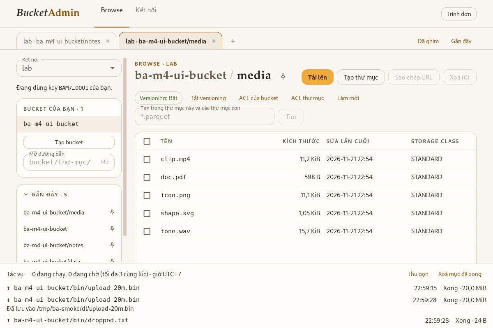

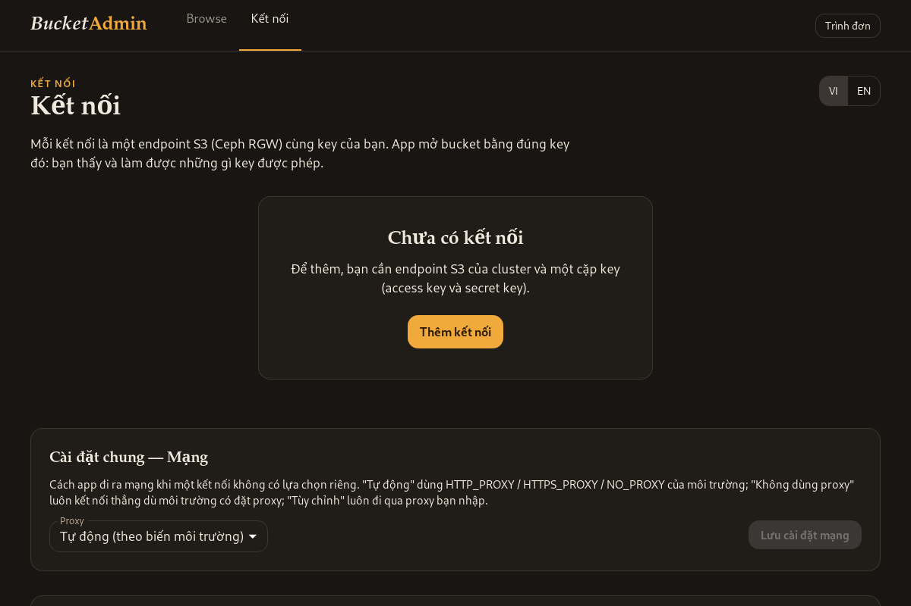


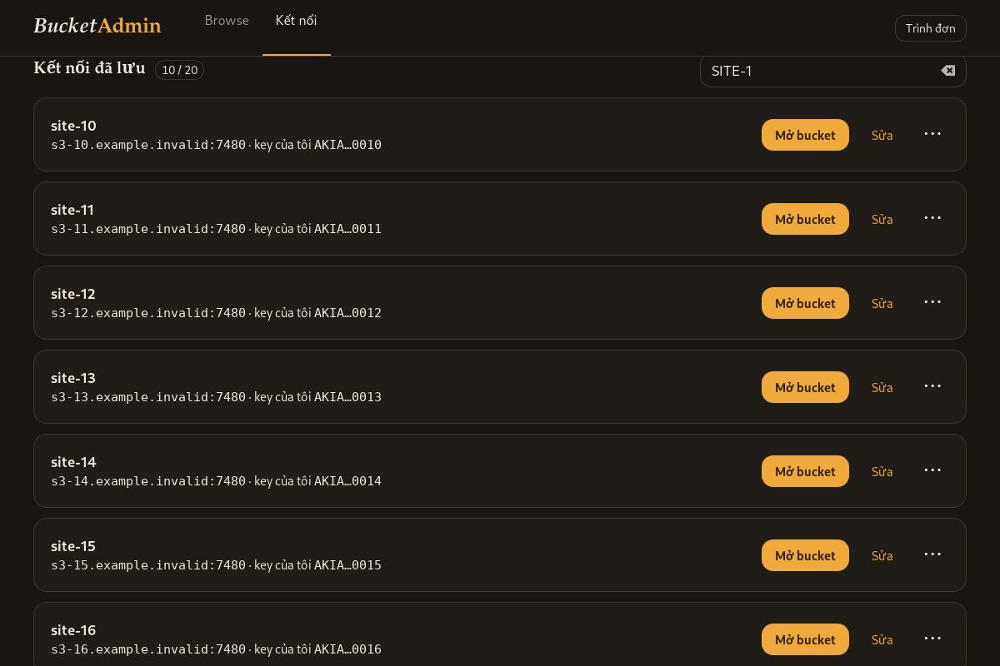

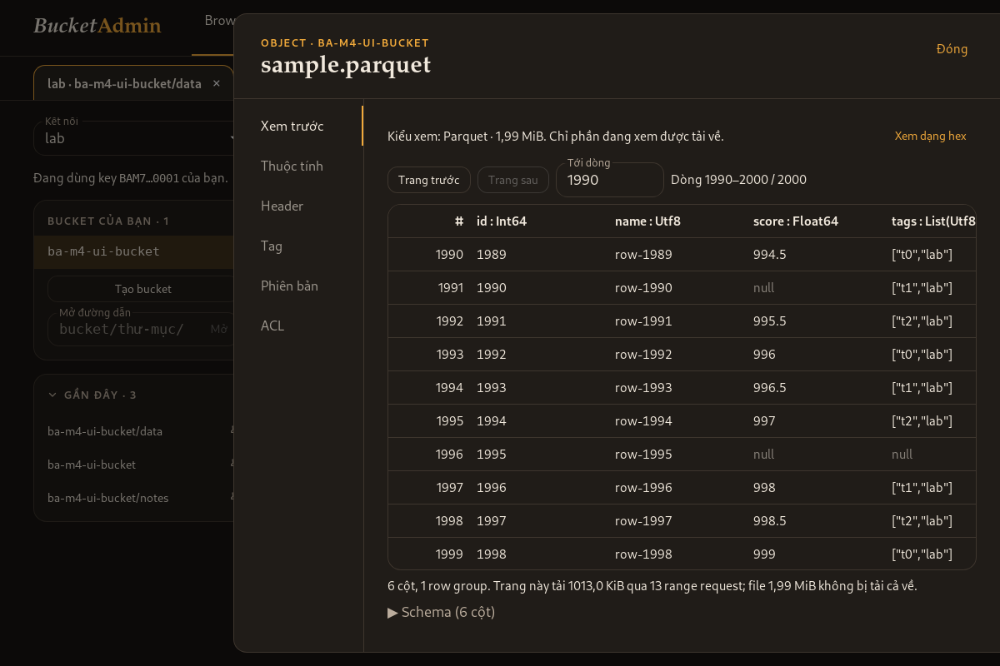

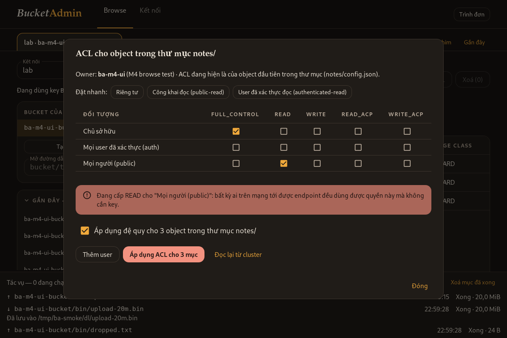

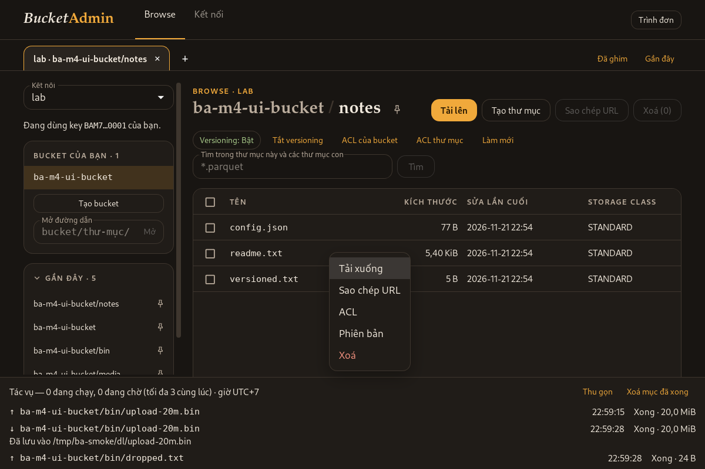


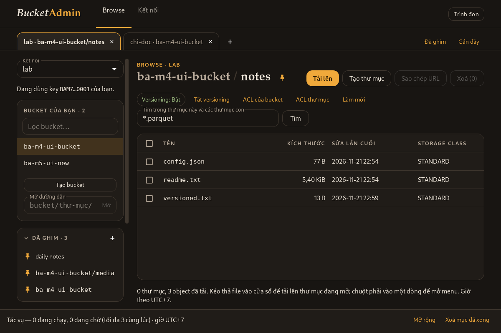

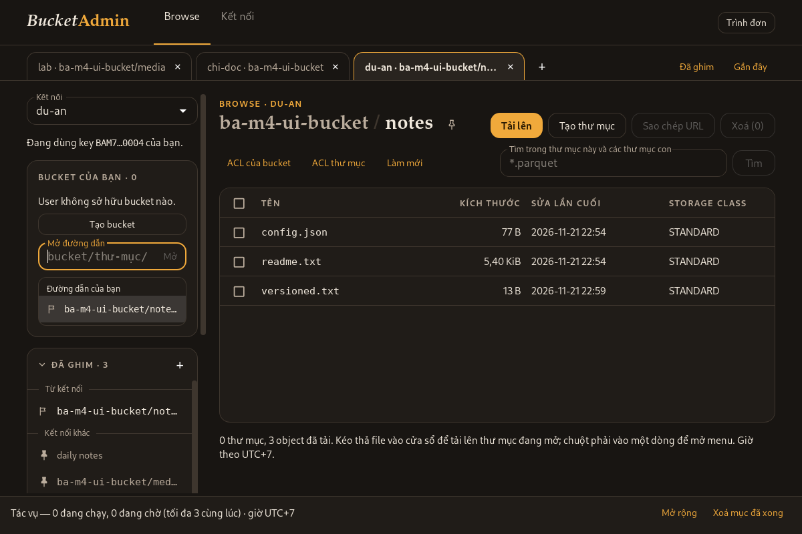

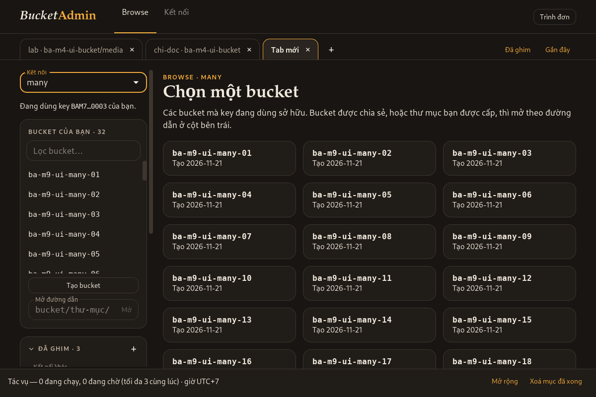

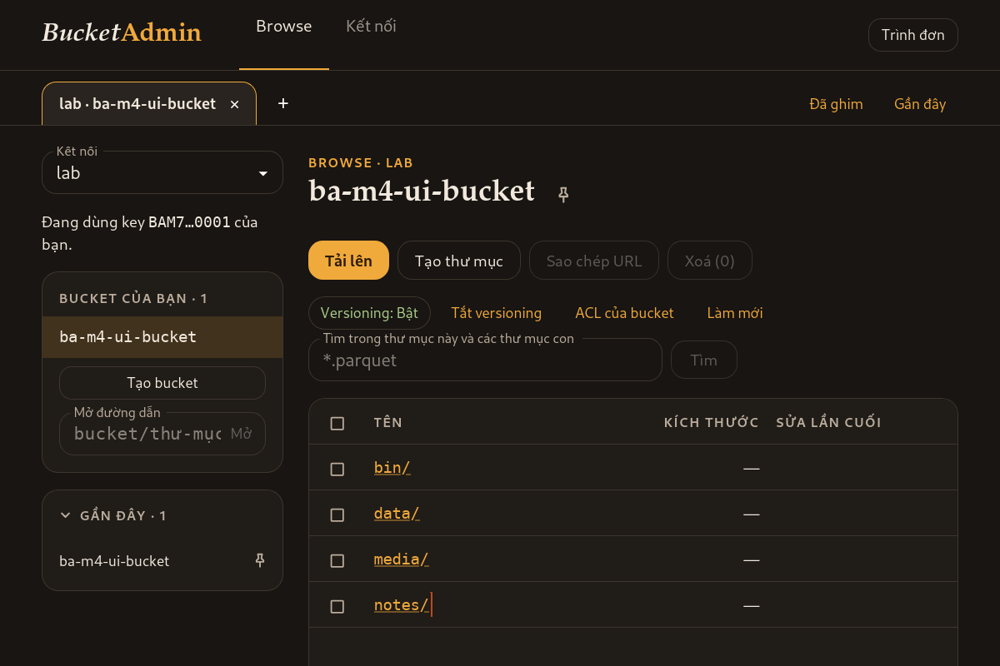

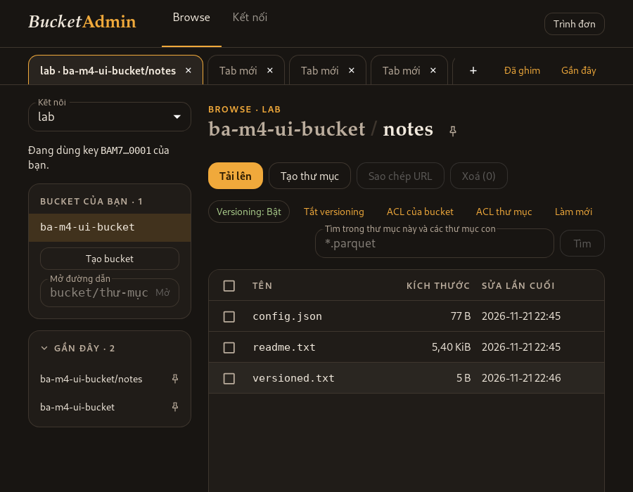

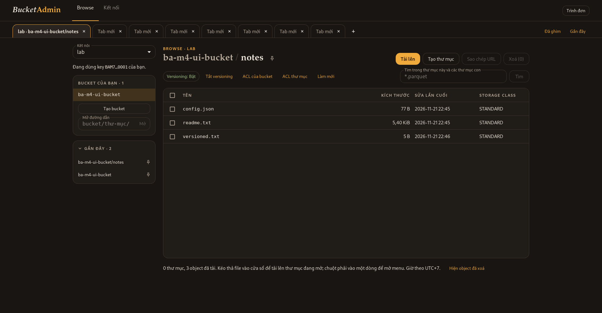

## Cài đặt

Yêu cầu: Ubuntu 22.04 trở lên (amd64), có dịch vụ keyring (GNOME Keyring hoặc tương đương — mặc định có sẵn trên Ubuntu desktop).

```bash
wget https://github.com/DucLong06/bucketadmin/releases/download/v0.1.3/bucketadmin_0.1.3_amd64.deb
sudo apt install ./bucketadmin_0.1.3_amd64.deb
```

Các định dạng khác và các bản cũ: trang [Releases](https://github.com/DucLong06/bucketadmin/releases).

Mở **BucketAdmin** từ menu ứng dụng, hoặc gõ `bucketadmin`.

Gỡ: `sudo apt remove bucketadmin`. Dữ liệu của app nằm ở `~/.local/share/bucketadmin/` (danh sách kết nối, cài đặt, audit log).

Để phát được video / audio nén trong phần xem trước, máy cần codec của GStreamer:
`sudo apt install gstreamer1.0-libav gstreamer1.0-plugins-good`.

## Bắt đầu nhanh

**1. Thêm kết nối.** Mục **Kết nối** → **Thêm kết nối** → điền bốn ô bắt buộc: tên, endpoint (đã có sẵn `https://`; ví dụ
`https://rgw.example.com` hoặc `http://rgw.example.com:7480`), access key và secret key của bạn → **Kiểm tra kết nối** (kết
quả hiện ngay trong form) → **Lưu**. Nút Lưu chỉ bấm được khi đủ bốn ô, và cho biết ô nào còn thiếu trước tiên. Bước kiểm
tra chỉ liệt kê bucket qua S3, nên key thường không có caps nào cũng dùng được. Đường dẫn bắt đầu, key admin và proxy riêng
nằm trong phần **Nâng cao**, phần lớn kết nối không cần tới. Kết nối đã lưu có nút **Mở bucket**, **Sửa** (đường dẫn bắt
đầu, proxy) và một trình đơn gồm Kiểm tra và Xoá.

**2. Browse.** Mục **Browse** → chọn một bucket. Bucket được chia sẻ cho bạn (S3 không liệt kê) thì mở theo đường dẫn ở ô
**Mở đường dẫn** của cột bên trái.

**3. Làm việc với object.** Bấm vào tên để xem trước; chuột phải vào dòng để mở menu; tick nhiều dòng để xoá một lượt; kéo thả
file vào cửa sổ để tải lên thư mục đang mở.

**4. Chia sẻ.** "ACL của bucket" / "ACL thư mục" trên thanh công cụ, hoặc ACL của từng object trong menu chuột phải.

### Quyền theo thư mục (chỉ một thư mục)

Ở nhiều cụm, user chỉ được cấp một thư mục trong bucket của người khác: bucket policy chỉ cho liệt kê dưới một prefix, và
thường key không được liệt kê bucket. Với key như vậy:

- **Mở đường dẫn** (cột bên trái của mục Browse) nhận `bucket` hoặc `bucket/thư-mục/…` và tới đúng nơi đó. `s3://bucket/thư-mục/`
  hay có dấu `/` ở đầu cũng như nhau; đường dẫn của một file (`bucket/thư-mục/report.csv`) thì mở thư mục chứa file. Thư mục
  có tên giống tên file (`v1.2`) thì cần dấu `/` ở cuối.
- **Đường dẫn bắt đầu** (không bắt buộc, trong phần Nâng cao của form; với kết nối đã lưu thì bấm Sửa): gõ
  `team-bucket/project-a/` rồi nhấn `Enter` để thêm thành một thẻ, `×` để bỏ; một kết nối có thể có nhiều đường dẫn. Đường
  dẫn đầu tiên tự mở mỗi khi mở kết nối đó, ở mọi tab mới. Tất cả đều được gợi ý ở mục "Đường dẫn của bạn" của bộ chọn
  đường dẫn và là những dòng đầu của khung Đã ghim, dưới vạch "Từ kết nối".
- Khi key không được liệt kê bucket, khung bucket nói rõ điều đó thay vì báo lỗi, và con trỏ đã nằm sẵn trong ô Mở đường dẫn.
  "Kiểm tra kết nối" vẫn đạt với key như vậy và nhắc bạn đặt đường dẫn bắt đầu.
- Thanh đường dẫn vẫn đi ngược lên được. Phía trên thư mục của bạn, S3 trả lời "không có quyền"; thông báo khi đó chỉ lại về
  ô Mở đường dẫn.

### Vị trí đã ghim

Ghim những nơi bạn dùng hằng ngày: một bucket, hoặc một thư mục sâu bao nhiêu cấp cũng được.

- Ghim vị trí đang mở bằng nút ghim ở cuối thanh đường dẫn, hoặc `Ctrl+D`; làm lại lần nữa là bỏ ghim.
- Chuột phải vào một bucket ở cột bên trái, hoặc một thư mục trong danh sách, để chọn "Ghim bucket" / "Ghim thư mục này"; mỗi
  dòng của Gần đây cũng có nút ghim.
- Khung **Đã ghim** ở cột bên trái liệt kê trước các vị trí của kết nối đang mở, các kết nối khác nằm dưới một vạch ngăn.
  Bấm là mở trong tab hiện tại; `Ctrl`+bấm hoặc nút chuột giữa thì mở tab mới.
- Chuột phải vào một vị trí đã ghim để mở trong tab mới, đổi tên, bỏ ghim, chuyển lên hoặc chuyển xuống. Tối đa 100 vị trí.
- Nút **Đã ghim** cạnh Gần đây trên thanh ứng dụng liệt kê 15 vị trí đầu, dùng được ở mọi nơi trong app.
- Ở cột bên trái, danh sách bucket đứng đầu; khung **Đã ghim** và **Gần đây** nằm dưới nó. Bấm vào tiêu đề của một khung để
  thu khung về đúng một dòng đó (nhớ qua các lần mở app); Gần đây hiện 5 vị trí mới nhất cho tới khi bấm "Hiện tất cả".

### Key admin (không bắt buộc)

Khi thêm kết nối có thể nhập thêm một key admin (trong phần Nâng cao). App chỉ dùng nó cho hai việc, và không bao giờ dùng nó để ký request S3:

| Việc | Caps cần ở key admin |
|---|---|
| Khung "Thông tin của tôi" trong mục Browse: thông tin, quota của user sở hữu key của bạn | `users=read` |
| Usage 30 ngày trong khung đó | `usage=read` |
| "Thao tác thay user (uid)": làm việc bằng key của một user khác | `users=read` |

Nếu chính key của bạn có các caps trên thì không cần key admin: khung "Thông tin của tôi" tự hiện.
Các màn hình quản trị cụm (user, key, caps, quota, onboarding từ CSV) đã được gỡ khỏi app từ bản 0.1.0.

## Phím tắt

| Phím | Việc |
|---|---|
| `Ctrl+T` | Tab mới |
| `Ctrl+W` | Đóng tab đang mở |
| `Ctrl+Tab` / `Ctrl+Shift+Tab` | Sang tab sau / tab trước |
| `Ctrl+D` | Ghim hoặc bỏ ghim vị trí đang mở |
| `Ctrl+=` (hoặc `Ctrl++`) | Phóng to giao diện một nấc |
| `Ctrl+-` | Thu nhỏ giao diện một nấc |
| `Ctrl+0` | Về cỡ 100% |
| `Ctrl+F` | Tìm trong file văn bản đang xem trước |

## Bảo mật

- Secret key: chỉ trong keychain của hệ điều hành; giao diện không bao giờ nhận được secret.
- Mở bucket: ký bằng key của bạn. Khi "thao tác thay user", app lấy key của user đó bằng key admin và chỉ giữ nó trong bộ nhớ.
- Cửa sổ chính không tải bất kỳ tài nguyên nào từ ngoài app; xem trước ảnh / media / PDF nằm trong một khung riêng chỉ được phép
  tải từ đúng endpoint của cluster.
- Presigned URL: mặc định 15 phút; audit log ghi việc tạo URL nhưng không ghi URL.
- Kiểm tra bản mới: mỗi ngày tối đa một request tới `api.github.com` (qua cài đặt proxy của app) để đọc tag release mới nhất;
  chỉ báo khi release đó mới hơn bản bạn đang chạy. Request không mang dữ liệu nào của bạn; không tới được GitHub thì app im
  lặng bỏ qua.

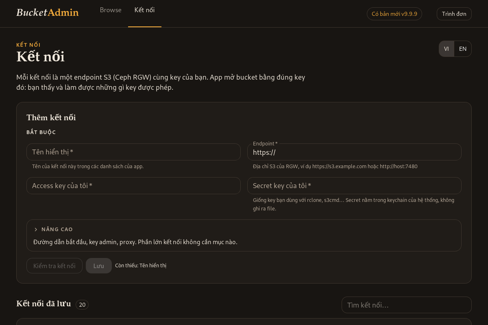

Chi tiết từng directive của CSP và cách xử lý presigned URL: [docs/SECURITY.vi.md](docs/SECURITY.vi.md) ([English](docs/SECURITY.md)).

## Lỗi thường gặp

| Hiện tượng | Nguyên nhân và cách xử lý |
|---|---|
| "Secret key … không khớp" / "không đúng" (SignatureDoesNotMatch) | Sai secret key, hoặc đồng hồ máy lệch nhiều so với cụm. Kiểm tra lại key và `timedatectl`. |
| "Access key không tồn tại trên cluster này" | Access key gõ sai, hoặc endpoint trỏ sang cụm khác. |
| "Không đủ quyền: key của cluster này thiếu caps …" | Chỉ gặp ở khung "Thông tin của tôi" hoặc khi thao tác thay user: key admin (hoặc key của bạn) thiếu cap đó. Thông báo kèm sẵn lệnh `radosgw-admin caps add` để gửi cho quản trị cụm. |
| "Không kết nối được tới RGW", hoặc lỗi HTTP 502 / 504 / 407 | Sai endpoint / port, hoặc request đang đi qua proxy mà proxy không tới được cụm. Với endpoint nội bộ: mục **Kết nối** → Proxy của kết nối đó → **Không dùng proxy**. |
| "Bucket không tồn tại" / lỗi HTTP 404 khi kiểm tra kết nối | Endpoint không phải là địa chỉ S3 của RGW (sai host, sai port, hoặc trỏ vào dashboard). |
| Usage trong "Thông tin của tôi" luôn trống | RGW chưa bật ghi usage: quản trị cụm đặt `rgw_enable_usage_log = true` rồi restart RGW. |
| "Key của user này không có quyền" | Đúng như tên gọi: key đang dùng bị policy, ACL hoặc op-mask chặn. Đây là quyền thật của key. |
| "Key của user này không có quyền…" ngay khi mở một bucket, hoặc "Key này không được liệt kê bucket" | Key được cấp một thư mục chứ không phải cả bucket: gõ đường dẫn của thư mục đó vào ô **Mở đường dẫn**, và lưu nó làm đường dẫn bắt đầu của kết nối (xem Quyền theo thư mục). |
| Không lưu được kết nối, báo lỗi keychain | Máy không có dịch vụ keyring đang mở khoá. Cài / mở GNOME Keyring (`gnome-keyring`) rồi thử lại. |
| App mở chậm khoảng 25 giây | Gặp khi phiên làm việc không có dịch vụ keyring (máy tối giản, phiên SSH + X): desktop portal chờ keyring rồi mới trả lời. Trong phiên desktop đầy đủ có GNOME Keyring đang chạy thì app mở ngay. |
| Video / audio không phát trong phần xem trước | Thiếu codec GStreamer, xem mục Cài đặt. |
| `apt install` từ chối vì `libc6` | Gói được build cho bản Ubuntu mới hơn máy bạn. Dùng gói build cho Ubuntu 22.04 trên trang Releases. |

## Phát triển

```bash
npm ci
npm run tauri dev                      # chạy app ở chế độ phát triển
npm test && npm run build              # test và build frontend
cd src-tauri && cargo fmt --check && cargo clippy --all-targets -- -D warnings && cargo test
scripts/build-deb.sh 0.1.3~dev1        # đóng gói deb
scripts/render-gate.sh bucketadmin_0.1.3~dev1_amd64.deb   # kiểm tra gói vừa build có hiện giao diện thật
python3 scripts/gen-icons.py           # render lại bộ icon từ src-tauri/icons/icon.svg (cần google-chrome, Pillow)
```

Smoke test toàn bộ giao diện trên app thật với một RGW thử nghiệm (Xvfb; xem đầu file để biết các công cụ cần có):

```bash
npx tauri build --debug --no-bundle
xvfb-run -a -s "-screen 0 1280x900x24" scripts/ui-smoke/ui-smoke.sh "$PWD/src-tauri/target/debug/bucketadmin"
UI_LANG=en xvfb-run -a -s "-screen 0 1280x900x24" scripts/ui-smoke/ui-smoke.sh "$PWD/src-tauri/target/debug/bucketadmin"
```

Cùng một kịch bản chạy được với giao diện tiếng Việt (mặc định) và tiếng Anh (`UI_LANG=en`); ảnh trong hai file README lấy từ
hai lượt chạy đó. Mọi chuỗi hiển thị nằm trong `src/i18n/strings.ts`, hai bảng `en` và `vi` cùng một bộ khoá.

Test tích hợp với một RGW thật chạy khi có biến môi trường `RGW_ACCESS_KEY`, `RGW_SECRET_KEY` (và `RGW_ENDPOINT`, mặc định
`http://127.0.0.1:7480`); không có thì các test đó tự bỏ qua. Dùng một cụm thử nghiệm, không dùng cụm thật: test tạo và xoá user, bucket.

## Giấy phép

MIT — xem [LICENSE](LICENSE).
